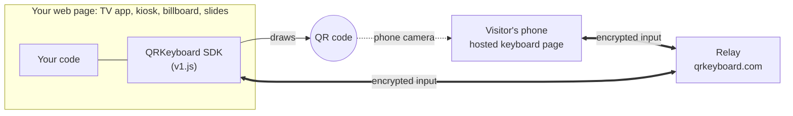
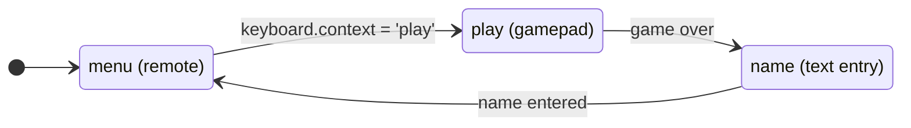
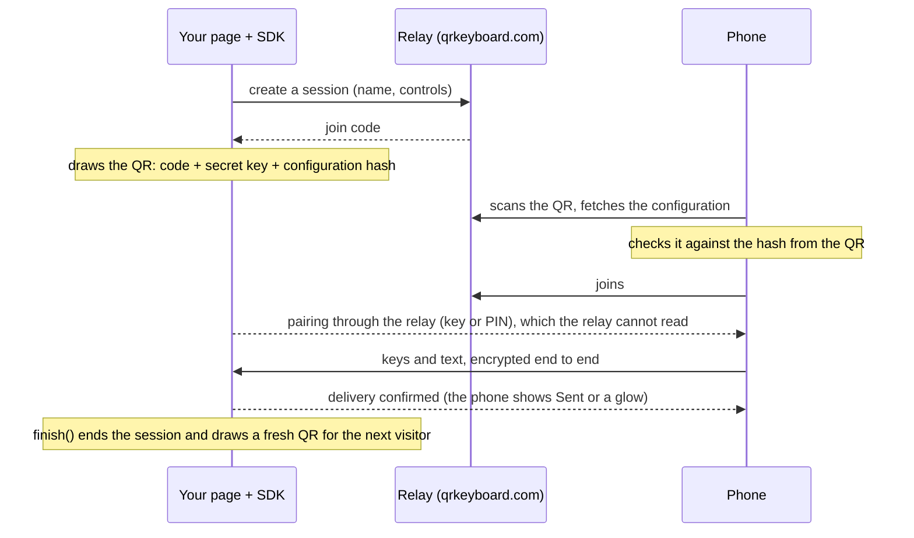

# QRKeyboard

**Put a QR code on your web page. Someone scans it, and their phone becomes a
keyboard, remote control or gamepad for your page.**

No app to install, no account, no backend to run. Your page loads one script,
shows the QR and receives the input. QRKeyboard supplies the QR, the phone
page, pairing, and an end-to-end encrypted connection between the two.



## Try it now

1. Open the [live demo](https://qrkeyboard.com/#demo) on a computer.
2. Scan the QR with your phone camera.
3. Type on the phone. The text appears on the computer.

Or try it on your own machine in a minute: save
[`examples/index.html`](examples/index.html), open it in a browser, and scan.
The phone and the computer do not need to be on the same network.

The live service runs the previous release, which offers live typing. Everything
else on this page (message mode, remotes, gamepads, layout switching, and the
hosted [billboard demos](examples/billboards/index.html)) is in this repository
and [pending deployment](RELEASE_STATUS.md). Once it ships, the demos are at
`https://qrkeyboard.com/examples/billboards/`.

## Add it to your page

```html
<div id="qr"></div>
<pre id="text"></pre>
<script src="https://qrkeyboard.com/v1.js"></script>
<script>
  const output = document.querySelector('#text');
  const keyboard = QRKeyboard.create({ el: '#qr', name: 'My screen', caps: ['keyboard'] });
  keyboard.on('key', event => {
    if (event.text !== undefined) output.textContent += event.text;
    else if (event.code === 8) output.textContent = [...output.textContent].slice(0, -1).join('');
    else if (event.code === 10) output.textContent += '\n';
  });
  keyboard.on('finish', () => { output.textContent = ''; });
</script>
```

That is the whole integration: a script, a place for the QR, and a handler.
The QR panel shows its own instructions and status. Upload the page to any HTTPS
static host; see [Deploy your page](DEPLOY.md).

A TV-style remote is one option and one handler:

```js
const keyboard = QRKeyboard.create({ el: '#qr', name: 'Living room TV', layout: 'remote' });
keyboard.on('keydown', ({ key }) => {           // W3C key names; arrows repeat while held
  if (key === 'ArrowDown') moveFocus(+1);
  if (key === 'Enter') openSelected();
});
```

If your app has stages, give the phone a layout for each and switch as you go:

```js
const keyboard = QRKeyboard.create({
  el: '#qr', name: 'Arcade',
  layouts: { menu: 'remote', play: 'gamepad', name: [{ type: 'text' }] },
  context: 'menu',
});
startButton.onclick = () => { keyboard.context = 'play'; }; // the phone follows at once
```



## What the phone can show

| Choose | Phone shows | You handle |
|---|---|---|
| default | A text box; edits appear as they are typed | `key` |
| `mode: 'text'` | A text box with Send (or your label) | `text` |
| `actions: [...]` | Your named buttons, such as Previous / Next slide | `action` |
| `layout: 'remote'` | D-pad and OK, Back, Home, Menu, volume, channel, play, colour keys | `press`, `keydown`, `keyup` |
| `layout: 'teletext'` | Colour keys, number pad, page and subpage keys | `press`, `keydown` |
| `layout: 'gamepad'` | D-pad and A / B | `keydown`, `keyup` |
| `layout: [...]` | Your own mix of a text box, a D-pad and key grids | as above |
| `layouts` + `context` | Several of the above, switched by your page | as above |

Keys arrive as standard [W3C key names](https://www.w3.org/TR/uievents-key/)
(`ArrowUp`, `Enter`, `ChannelUp`, `ColorF0Red`), so with the `target` option an
existing TV web app that already handles keyboard remotes needs no new code.

## How it works



- **Private by design.** The pairing key travels in the QR's `#fragment`, which
  browsers never send to a server. Every connection derives fresh AES-256-GCM
  keys; the relay forwards sealed frames it cannot read, replay or reorder.
- **What the relay does see:** IP addresses, timing and frame sizes, and the
  screen's public configuration (its name and button labels). A hash in the QR
  stops the relay from changing that configuration.
- **Optional PIN.** `pin: true` shows a PIN beside the QR; pairing uses SPAKE2,
  so each attempt tests a single guess (nothing can be guessed offline from a
  recording), and five failures in a row lock the screen until it restarts.
- **One visitor at a time.** A second phone is turned away. `finish()` (or the
  phone's Finish) ends the session so old links stop working.
- **Input goes one way.** The screen only confirms delivery and names which of
  its declared layouts to show; it cannot put other text on the phone.

## Examples

| Example | What it shows |
|---|---|
| [Starter](examples/index.html) | Live typing into a page (works on the live service today) |
| [Message entry](examples/message.html) | Compose, then Send |
| [Presentation](examples/presentation.html) | PIN, Previous slide, Next slide |
| [TV remote](examples/remote.html) | D-pad, OK, volume and channel driving a TV-style menu |
| [Billboard demos](examples/billboards/index.html) | Six big-screen experiences: neon wall, skywriter, light-cycle game, split-flap board, flow mural, teletext |

Each is a single HTML file. The [example guide](examples/README.md) explains how
to run and copy them.

## Documentation

- [Quick start](QUICKSTART.md): from an empty folder to a working page.
- [API reference](DEVELOPER_GUIDE.md): every option, event, layout and the wire protocol.
- [Deploy your page](DEPLOY.md): publish it and troubleshoot.
- [Use cases](USE_CASES.md): the interaction patterns, and what is out of scope.
- [Embedded devices](LOW_END_MCU.md): firmware and bridge integration.
- [Release status](RELEASE_STATUS.md): what is implemented versus deployed.
